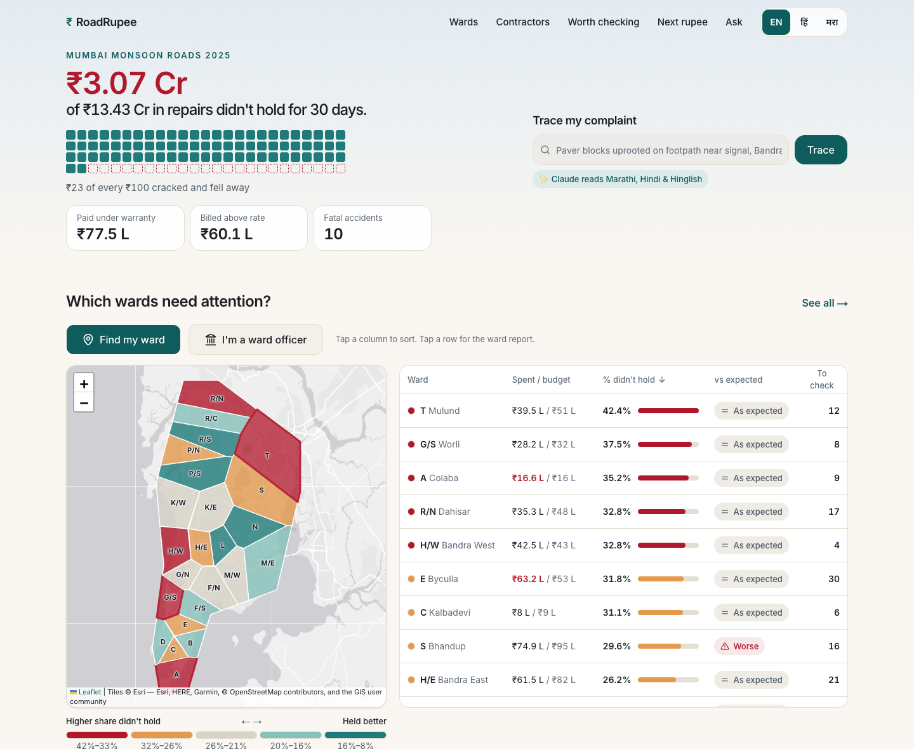

# RoadRupee

**Where did the repair money go, and did the fix hold?**

🌐 **Live app: https://roadrupee-frontend.graygrass-b61bee71.centralindia.azurecontainerapps.io**

🎬 **Demo video (1 min 46 s): [docs/demo/RoadRupeeDemo.mp4](docs/demo/RoadRupeeDemo.mp4)** · [direct download](https://github.com/mechdeveloper/roadrupee/raw/main/docs/demo/RoadRupeeDemo.mp4)



Built for Claude Impact Lab Mumbai ("Follow the Rupee: Mumbai Monsoon Roads"). Every monsoon Mumbai spends crores fixing the same roads, and the potholes come back. RoadRupee shows, for each ward, where the road repair money went, whether the work held up, who is responsible, and where the next rupee should go.

> **All data is synthetic and all contractors are fictional.** Nothing here is real BMC data. Don't use it to judge any real person, contractor or department.

**North Star:** *"From a citizen's complaint to a ward officer's action, with evidence at every step."* Python does all the maths; Claude reads messy language, writes plain explanations and gives a separate opinion, and never invents numbers or changes rule results. Full text: [CLAUDE.md](CLAUDE.md#north-star).

## What it does
1. **Home dashboard.** The headline is computed from the data: ₹3.07 Cr of ₹13.43 Cr (23%) was spent on repairs that failed within 30 days. A ward map and league table, eight contractor report cards, the flags most worth checking, a monsoon-vs-failures chart and the spend by repair method are all one click from the first screen.
2. **Audit engine.** Plain Python (pandas), no LLM arithmetic. Five rules; every flag lists its work order ids, severity and reason. Claude adds a separate opinion and never changes a rule result.
3. **Ward reports** that answer four questions: where did the money go, did the fixes hold (actual vs expected, with the monsoon timeline), what's worth checking, and where should the next rupee go. Officer mode adds Print and CSV actions.
4. **An evidence page for every flag:** the claim, how we checked it step by step, the context (rain, warranty, engineer's remark, complaints), Claude's view, and an RTI draft.
5. **Trace my complaint** in Marathi, Hindi, Hinglish or English (or a complaint ID): follows it to the work order, contractor, cost vs the rate card, whether the fix held and whether the road was under warranty, then answers in your language.
6. **Next rupee:** a transparent risk score per road segment, the most durable repair method (not the cheapest) and a budget fit.

The interface is in English, हिन्दी and मराठी (toggle in the nav). Wording is deliberately fair: "worth checking", never "fraud".

---

## For judges

### Where to look
| Judging criterion | Where in the app |
|---|---|
| Audit accuracy | [`/audit`](https://roadrupee-frontend.graygrass-b61bee71.centralindia.azurecontainerapps.io/audit) and `/api/flags.csv` (below, 391 audit findings); each flag's evidence page, e.g. `/flag/F0001` |
| Fair accountability | A ward page → "Did the fixes hold?"; `/contractors` and `/contractor/CT04` |
| Budget smarts | A ward page → "Where should the next rupee go?"; `/plan` |
| Connects the trail | [`/trace`](https://roadrupee-frontend.graygrass-b61bee71.centralindia.azurecontainerapps.io/trace) |
| Usable + demo | Home, the language toggle, officer mode (`/ward/t?mode=officer`), print and share |

### Check our audit
- **Download:** `GET /api/flags.csv` (**our audit findings: the 391 audit-tier flags**, one row per flag, `work_order_id` first) or `GET /api/flags_all.csv` (everything, including the lower-priority review items; the `tier` column says which), or the filterable list at `/audit`. Its CSV button (`/api/audit.csv`) respects the filters.
- **Columns:** `work_order_id, rule, tier, severity, reason, related_work_order_ids, ward_code, road_id, contractor_id, cost_inr, expected_inr, amount_inr, claude_verdict, claude_headline`. For a flag spanning several jobs (double bills, repeat failures) the primary job comes first and the others are in `related_work_order_ids`, pipe-separated.
- **Two tiers.** **audit** = confident enough to put in front of a judge. **review** = a real signal that also has ordinary explanations, so it is shown separately and not counted as a finding.

| Rule | Tier | Threshold | Flags |
|---|---|---|---:|
| `OVER_RATE` | audit | billed more than **1.5×** the rate card (rate × area, or the flat rate). Normal variation is ±20–30%, so that is *not* flagged | 109 |
| `DOUBLE_BILL` | audit | same road and same repair method assigned **under 7 days** apart, and the later job has **no linked complaint** | 45 |
| `DLP_PAID` | audit | road still under its Defect Liability Period, BMC paid, and the job is a **surface defect** the original contractor is liable for (pothole, broken paver blocks or road cave-in, with a surface method) and the engineer's remark has no MTNL/MGL utility trench | 237 |
| `DLP_PAID` | review | any other paid job on a DLP road (drains, manholes, pumping, utility trenches): "DLP road, but work not covered by the road contractor's liability" | 256 |
| `SLA_BREACH` | review | completed in **more than 2×** the target hours (plain misses are a scorecard metric, not a flag) | 488 |
| `REPEAT_FAILURE` | review | same road, same contractor, same repair method: **two or more** reopened jobs whose completion dates chain within **60 days** (30 flags covering 63 jobs; a single reopen is only a scorecard metric) | 30 |
| `SILENT_FAILURE` | review | a resident post (classified by Claude, cached in `backend/data_cache/social_posts.json`) says the problem is back, in the same ward and issue type, within **45 days** after a repair that was **not** reopened (49 flags from 55 posts). Ward-level match, not proven to be the same road; "every year" posts are weaker evidence | 49 |

Totals: **1,214 flags**, of which **391 are audit tier** (the "See all 391" on the home page). The counts are pinned by tests (`backend/tests/test_flags.py`); print them any time with `cd backend && uv run python -m app.engine.report`.

### Fairness method
- **Actual vs expected, not raw failure rates.** A ward's or contractor's reopen rate is compared with the rate we would *expect* for the repair methods it used (each method has its own baseline; cold mix fails more often than hot mix), adjusted for the **rain in the week after each repair** and the ward's **flood-proneness** (`low_lying_index`). The adjustment factors come from the data, are clipped to 0.7–1.5, and are calibrated so the city total matches.
- **Confidence intervals.** We write "better" or "worse than expected" only when the 95% Wilson interval of the observed rate excludes the expected rate; otherwise it says "about as expected". That is why most wards read "as expected" even when their raw failure share looks high.
- **Small samples are labelled** ("Few jobs: rough guide" under 10 jobs) and never read as verdicts. Bars compare shares, not totals, so busy wards are not singled out.
- **Contractor grades:** on-time delivery against the peer median (±5 points), durability against its expected rate (interval rule), and cost as the share of jobs billed over 1.5× against the city's share. Volume is neutral context.

### Where Claude is used, and the guardrails
| Feature | What Claude does | Model env var |
|---|---|---|
| Flag verdicts | `worth_checking` / `likely_justified` / `needs_more_info` with a headline and reasoning, from the flag's evidence pack. Precomputed for all 391 audit flags; any other flag on demand ("Ask Claude") | `CLAUDE_MODEL_LIVE` |
| Ward summaries | Three plain sentences per ward in English, Hindi and Marathi (all 24 precomputed) | `CLAUDE_MODEL_LIVE` |
| Trace my complaint | Reads messy Marathi / Hindi / Hinglish text: language, locality (matched to the gazetteer, incl. Devanagari aliases) and issue type; then writes the answer in the user's language | `CLAUDE_MODEL_EXTRACT`, `CLAUDE_MODEL_LIVE` |
| Next-rupee one-liners | One sentence per road for the top 10 roads of every ward (precomputed) | `CLAUDE_MODEL_LIVE` |

Guardrails (code in `backend/app/ai/`):
- **Numbers only from evidence.** Every ₹ amount, percentage and multiplier in Claude's text is checked against the evidence it was given; one retry, then a deterministic template. Claude does no arithmetic.
- **No blame words** (fraud, scam, corrupt, theft …) and sentence and word limits are checked the same way.
- **Claude never changes a rule result or tier.** Its verdict is a separate field; the CSV shows both.
- **Deterministic fallback everywhere.** Without a key, on a timeout or on an API error the app shows an automatic summary instead of an error. The RTI drafts are deterministic English and Marathi templates.
- **Live-endpoint protection:** `/api/trace` and `/api/explain` are limited to 20 requests per minute per client; cached answers are free.

### Next-rupee formula (`backend/app/engine/planner.py`)
Risk score 0–100 per road segment = the sum of five visible parts:

| Part | Max | Built from |
|---|---:|---|
| Open complaints | 30 | open and in-progress complaints matched to the nearest road segment in their ward, weighted by severity (derived from the SLA ladder: cave-in and open manhole 5, waterlogging 4, drain and pothole 3, paver 2) and by "me too" votes |
| Flooding | 25 | nearest chronic flood spot within 1.5 km: years flagged, +50% if tide-sensitive, nearer is worse |
| Traffic | 15 | congestion index (70%) and bus routes (30%) |
| Accidents | 15 | pothole, waterlogged-road and open-chamber accidents: fatal 3, grievous 2, minor 1 |
| Schools and hospitals | 15 | a hospital with emergency services as the road's ambulance entry = 1.0, a municipal school = 0.6 |

The recommended method is the one with the **lowest 30-day reopen rate** among the methods actually used for that kind of work (for potholes, hot mix 22.6% vs cold mix 32.2%), not the cheapest. Cost is the rate card × the typical area for that method in the ward. Roads are funded in rank order against `budget − spend`; an item that doesn't fit is skipped so a smaller one below can still be funded. **Overspent wards** (six of them) fund nothing and say so. The formula is shown in the UI and returned by `GET /api/plan?ward=g-s` (contract: [CLAUDE.md](CLAUDE.md#planner-contract)).

### Known data limits
- **Everything is synthetic** and contractors are fictional. Findings describe the dataset, not any real person or firm.
- **Rainfall data ends 30 Sep 2025**, but repairs run to 10 Oct, so October shows "no rainfall data".
- **Ward boundaries are approximate** (a Voronoi sketch around ward centres, not official polygons).
- **No failure date is recorded**, only "reopened within 30 days", so failure markers sit on the day the repair was finished (the charts say so).
- **Complaints carry no road id.** We match open complaints to the nearest road segment in their ward (GPS if present, else the locality centroid). About 18% of reported complaint categories are wrong or vague.
- **Accident data has no death counts,** so the home page says "fatal accidents".
- Devanagari aliases exist for only 15 of 118 localities; Trace relies on Claude to normalise the rest. **Hindi and Marathi copy was written by us and needs a native-speaker review.**
- 3 of the 233 top-10 roads have no Claude one-liner (it failed our guardrail); the page simply shows none.

### A 2-minute demo path
1. **Home** (`/`, 0:00): the ₹3.07 Cr headline counts up, the ₹100 bar cracks, the map and league table sit side by side.
2. **Ward** (0:25): click **T** (Mulund) → "Where did the money go?" (contractor bars, flow chart) → "Did the fixes hold?" (monsoon timeline, verdict) → try **officer mode** for Print and CSV.
3. **Flag evidence** (0:55): "Worth checking" → a flag, e.g. [`/flag/F0001`](https://roadrupee-frontend.graygrass-b61bee71.centralindia.azurecontainerapps.io/flag/F0001): the claim, how we checked it, the context, Claude's view, the RTI draft.
4. **Trace in Marathi** (1:25): paste `Madanpura मध्ये पाणी साचले आहे, गाड्या अडकल्या आहेत. पंप पाठवा.` into the home box → the six-step trail, a Marathi answer and the Marathi RTI draft. Switch the language toggle to मराठी.
5. **Next rupee** (1:45): ward **G/S** → "Where should the next rupee go?": tick roads and watch the budget bar fill; Print.

---

## Run it
```bash
cp .env.example .env        # add your own ANTHROPIC_API_KEY (only needed for live Claude calls)
docker compose up --build   # http://localhost:3000
```
Without Docker:
```bash
cd backend && uv sync && uv run fastapi dev app/main.py        # :8000
cd frontend && npm install && npm run dev                      # :3000 (BACKEND_URL=http://localhost:8000)
```
- **Tests:** `cd backend && uv run pytest` (114 tests: audit counts, contracts, planner rules, trace paths, guardrails, rate limit).
- **Smoke-test any deployment:** `scripts/smoke.sh <base-url>` checks the home page, a ward page, `/trace`, `/api/health`, `/api/flags.csv` and `/api/plan/city`.
- **Deploy to Azure Container Apps:** `infra/deploy-aca.sh` (needs `az login` and `ANTHROPIC_API_KEY`).
- **Setup:** copy `.env.example` to `.env` and add your own key. **Never commit `.env`** (it is git-ignored and excluded from Docker images).

## Repo map
`backend/` FastAPI, audit engine, Claude modules · `frontend/` Next.js (same-origin `/api/*` proxy) · `data/` dataset · `infra/` Azure deploy · `scripts/` smoke test · `DESIGN.md` · `CLAUDE.md` (product, data contract, rules) · `CONTRIBUTING.md`

## Data attribution
Dataset: **Follow the Rupee: Mumbai Monsoon Roads** by Sumeet Doshi, Claude Community Ambassador, Anthropic, for Claude Impact Lab Mumbai. Source: https://github.com/SumeetGDoshi/Claude-Impact-Labs-data-2. Licensed [CC BY 4.0](https://creativecommons.org/licenses/by/4.0/). Included unmodified in `data/` with its original README and DATA_DICTIONARY.md. Basemap: Esri, HERE, Garmin, © OpenStreetMap contributors.

The code in this repository was written from scratch during the hackathon.
